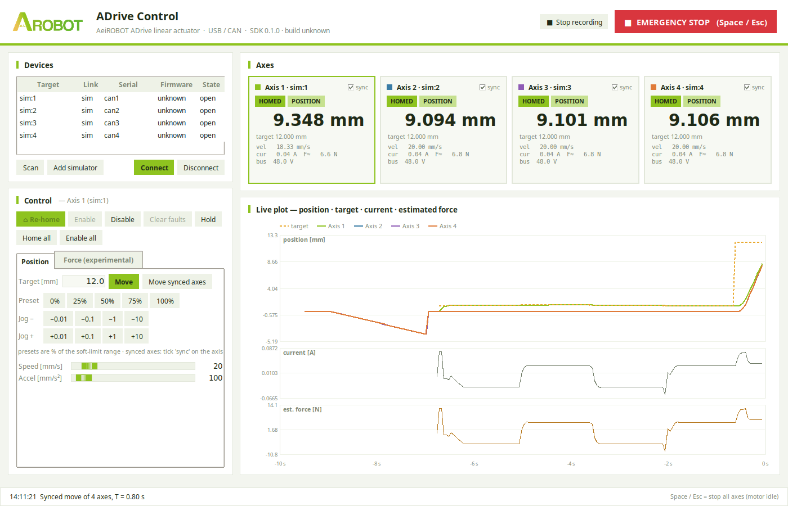

<p align="center">
  
</p>

<h1 align="center">ADrive SDK</h1>

<p align="center">
  <b>리니어 액추에이터를 Python 다섯 줄로.</b><br>
  AeiROBOT ADrive LH42A · SDK · GUI · Examples
</p>

<p align="center">
  <a href="https://github.com/roscore/adrive-sdk/releases/tag/v0.1.1"></a>
  
  
  <a href="LICENSE"></a>
</p>

<p align="center">
  <a href="#한국어">한국어</a> · <a href="#english">English</a>
</p>

<p align="center">
  
</p>

---

## 한국어

### 200 mm/s. 2000 mm/s². 48 V.

| 200 mm/s | 2000 mm/s² | 48 V DC | 3.10+ |
|:---:|:---:|:---:|:---:|
| 최고 속도 | 최대 가속도 | 전원 | Python |

속도·가속도는 사내 시험에서 구동 확인한 값입니다. 기본 설정은 그 10 %로 시작합니다.

### Quick start

```bash
pip install sdk/adrive-0.1.1-cp310-abi3-win_amd64.whl
python -c "import adrive; print(adrive.build_info())"
```

```python
import adrive

act = adrive.connect()        # USB 또는 CAN에서 처음 찾은 액추에이터
act.home()                    # 전원을 켤 때마다 필수
act.enable()
act.move_to(10.0, speed=20.0) # mm, mm/s
print(act.position())
```

하드웨어 없이 시작하려면 `adrive.connect("sim:1")`.

### Features

- **USB 직결.** 드라이버 설치 없이 인식됩니다.
- **절대 위치 이동.** `move_to(mm, speed, accel)` — mm 단위, 소프트 리밋 적용.
- **호밍 강제.** 호밍 전에는 이동 명령을 받지 않습니다.
- **다축.** `connect_all()`로 연결된 액추에이터 전부를 한 번에. 동기 구동 예제 포함.
- **ADrive Control GUI.** 장치 탐색, 호밍, 조그, 동기 이동, 실시간 그래프, CSV 기록. Space·Esc로 전 축 정지.
- **게인 튜닝·스트로크 한계.** `set_gains()`·`restore_factory_gains()`(출하값의 0.2–5 배), `set_stroke_limits()`. GUI Tuning 창에서 스텝 응답을 보며 조정합니다.
- **시뮬레이터 내장.** `sim:N`으로 SDK·GUI·예제를 하드웨어 없이 실행합니다.
- **컴파일된 코어.** 단일 네이티브 모듈. 이 저장소에는 바이너리와 문서만 있습니다.

### Downloads

| 플랫폼 | SDK | GUI |
|---|---|---|
| Windows 10/11 x64 | [`adrive-0.1.1-cp310-abi3-win_amd64.whl`](sdk/) | [`ADrive-GUI.exe`](https://github.com/roscore/adrive-sdk/releases/tag/v0.1.1) |
| Linux aarch64 (glibc 2.34+) | [`adrive-0.1.1-cp310-abi3-manylinux_2_34_aarch64.whl`](sdk/) | `python gui/adrive_gui.py` |

모든 파일과 SHA-256은 [Releases](https://github.com/roscore/adrive-sdk/releases/tag/v0.1.1)에 있습니다.

### Docs

- [퀵스타트](quickstart/quickstart-ko.md) ([PDF](quickstart/quickstart-ko.pdf))
- [한 장 매뉴얼](ONE-SHEET.md)
- [4축 동기 구동 예제](examples/sync_4axis.py)

### Safety

- 액추에이터는 바이스나 볼트로 고정하십시오. 테이프·헐거운 받침 위에서 구동하지 마십시오.
- 손이 닿는 곳에 전원 차단형 하드웨어 E-stop을 두십시오.
- `stop()`, `estop()`, GUI 정지 버튼은 소프트웨어 정지입니다. 안전 인증 비상정지가 아닙니다.
- 전원을 켜기 전에 캐리지를 스트로크 중앙 부근(양 끝에서 15 mm 이상)에 두십시오. 전원 인가 직후 드라이브가 엔코더 인덱스를 스스로 탐색하며 캐리지가 짧게 움직입니다. 이때 엔드스톱·바이스·지그·부하에 걸리면 엔코더 오류 `CPR_POLEPAIRS_MISMATCH`(0x2)가 나고 모터가 꺼진 채 남습니다. 전원을 끄고 걸림을 제거한 뒤 다시 켜십시오.

### Notes

0.1.1 프리릴리스 기준입니다.

- 펌웨어 빌드 06 이상에서 SDK 연결을 확인했습니다. 06 이전의 기존 출하 펌웨어도 동작합니다. 06 직전의 일부 시험 빌드는 연결되지 않습니다(`E111`).
- CAN: 장치 탐색·상태 조회·정지를 지원합니다. CAN 구동은 지원하지 않습니다.
- CAN 어댑터(gs_usb, slcan, PCAN-Basic, SocketCAN)는 실제 버스에서 시험하지 않았습니다.
- 기본 설정의 위치 정확도는 0.01 mm에 미치지 않습니다.
- 힘 제어(`force_control`)는 실험 기능입니다. 로드셀로 검증하지 않았습니다.
- Windows 빌드는 시뮬레이터로 검증했습니다. 실제 액추에이터 구동 시험은 Linux에서 진행했습니다.
- 바이너리는 코드 서명되지 않았습니다. Windows SmartScreen 경고가 뜰 수 있습니다.

### License

Proprietary. [`LICENSE`](LICENSE) 참조. 서드파티 고지는 [`THIRD_PARTY_NOTICES.txt`](THIRD_PARTY_NOTICES.txt).

---

## English

### 200 mm/s. 2000 mm/s². 48 V.

| 200 mm/s | 2000 mm/s² | 48 V DC | 3.10+ |
|:---:|:---:|:---:|:---:|
| Top speed | Max acceleration | Supply | Python |

Speed and acceleration were run and confirmed in in-house testing. Defaults start at 10 % of these.

### Quick start

```bash
pip install sdk/adrive-0.1.1-cp310-abi3-win_amd64.whl
python -c "import adrive; print(adrive.build_info())"
```

```python
import adrive

act = adrive.connect()        # first actuator found on USB or CAN
act.home()                    # required after every power-up
act.enable()
act.move_to(10.0, speed=20.0) # mm, mm/s
print(act.position())
```

No hardware yet? Use `adrive.connect("sim:1")`.

### Features

- **Direct USB.** Recognized with no driver install.
- **Absolute moves.** `move_to(mm, speed, accel)` in millimetres, inside soft limits.
- **Homing enforced.** Motion commands are refused until homing is done.
- **Multi-axis.** `connect_all()` opens every connected actuator. Synchronized-move example included.
- **ADrive Control GUI.** Device scan, homing, jog, synced moves, live plot, CSV logging. Space or Esc stops all axes.
- **Gain tuning and stroke limits.** `set_gains()` / `restore_factory_gains()` (0.2–5x of factory), `set_stroke_limits()`. The GUI Tuning window shows the step response while you adjust.
- **Built-in simulator.** `sim:N` runs the SDK, GUI and examples without hardware.
- **Compiled core.** One native module. This repository holds binaries and documentation only.

### Downloads

| Platform | SDK | GUI |
|---|---|---|
| Windows 10/11 x64 | [`adrive-0.1.1-cp310-abi3-win_amd64.whl`](sdk/) | [`ADrive-GUI.exe`](https://github.com/roscore/adrive-sdk/releases/tag/v0.1.1) |
| Linux aarch64 (glibc 2.34+) | [`adrive-0.1.1-cp310-abi3-manylinux_2_34_aarch64.whl`](sdk/) | `python gui/adrive_gui.py` |

All files and SHA-256 sums are on [Releases](https://github.com/roscore/adrive-sdk/releases/tag/v0.1.1).

### Docs

- [Quickstart](quickstart/quickstart-en.md) ([PDF](quickstart/quickstart-en.pdf))
- [One-sheet manual](ONE-SHEET.md#english)
- [4-axis synchronized example](examples/sync_4axis.py)

### Safety

- Fix the actuator with a vise or bolted mount. Never run it on tape or a loose base.
- Keep a hardware E-stop that cuts power within reach.
- `stop()`, `estop()` and the GUI stop button are software stops. They are not safety-rated emergency stops.
- Before power-up, place the carriage near the middle of the stroke (at least 15 mm from either end). Right after power is applied the drive searches for the encoder index by itself and the carriage moves briefly. If it is blocked by the end stop, vise, fixture or load, the drive reports encoder error `CPR_POLEPAIRS_MISMATCH` (0x2) and stays off. Cut power, clear the obstruction and power up again.

### Notes

As of 0.1.1 prerelease.

- SDK connection is confirmed on firmware build 06 and later. Earlier production firmware also works. Some test builds just before 06 do not connect (`E111`).
- CAN: device discovery, status and stop are supported. Driving over CAN is not.
- CAN adapters (gs_usb, slcan, PCAN-Basic, SocketCAN) have not been tested on a real bus.
- Position accuracy with default settings does not reach 0.01 mm.
- Force control (`force_control`) is experimental and not verified with a load cell.
- The Windows build is verified against the simulator. Hardware runs were done on Linux.
- Binaries are not code-signed. Windows SmartScreen may warn on first run.

### License

Proprietary. See [`LICENSE`](LICENSE). Third-party notices: [`THIRD_PARTY_NOTICES.txt`](THIRD_PARTY_NOTICES.txt).
